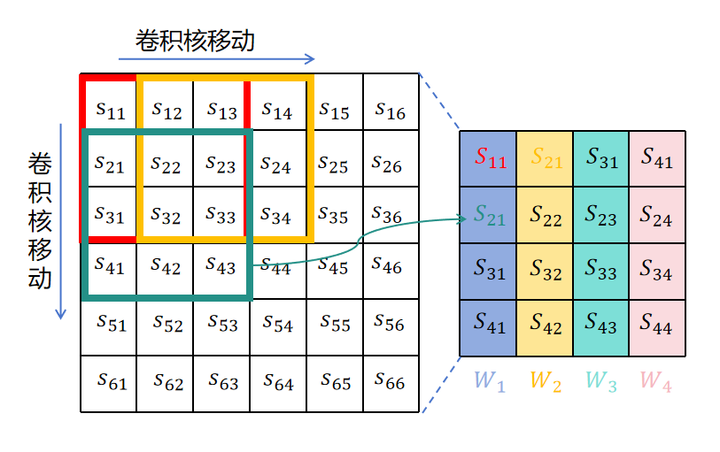

# 风损先知 · 台风灾害风险预测系统

风损先知是一个基于 Django 的台风灾害风险预测演示项目，使用 Python 3.11、SQLite、NumPy 和 pandas。首页使用扩展置信规则库（Extended Belief Rule Base，EBRB）预测台风直接经济损失的置信度分布。项目还包含一个独立的 Excel 风险分级实验脚本。

## 本地运行

在包含 `manage.py` 的项目根目录打开 PowerShell，创建新的虚拟环境：

```powershell
py -3.11 -m venv .venv
.\.venv\Scripts\python.exe -m pip install -r requirements.txt
.\.venv\Scripts\python.exe manage.py migrate
.\.venv\Scripts\python.exe manage.py check
.\.venv\Scripts\python.exe manage.py runserver
```

打开 [本地站点](http://127.0.0.1:8000/)，在登录页注册并登录。项目自带的 `venv/` 可能记录了原机器的 Python 路径，因此上述命令使用新建的 `.venv/`。

## 试跑经济损失预测

在首页分别上传 [训练示例](files/train.csv) 和 [测试示例](files/test.csv)。后台计算进度和结果会显示在页面上。使用自己的数据时，两份 CSV 都应满足以下格式：

- 使用 **GBK** 编码，包含 **7 个数值特征**，两份文件的特征列顺序一致。
- 都包含目标列 `直接经济损失(亿元)`，括号使用半角字符。测试集目标列用于展示实际损失。
- 特征和目标列使用完整的数值数据，地区或年份等文本标识列应事先移除。

## EBRB 如何预测损失

首页提交文件后，[Django 视图](users/views.py) 保存文件并启动后台线程。线程调用 [`loss_prediction.run()`](files/loss_prediction.py#L286)，由它读取 CSV、构建参考值并调用 [`CNN_EBRB()`](files/loss_prediction.py#L138)。网页通过 `/progress/` 的服务器推送事件（SSE）接收进度和最终结果。

1. **建规则。** 根据训练数据的范围，为每个输入特征生成 7 个等距参考值，为损失生成 8 个等距参考值。每条训练记录构成一条规则，特征和实际损失按所在区间线性分配给相邻参考值。例如，数值 12 位于参考值 10 和 20 之间，对这两个参考值的置信度分别为 0.8 和 0.2。
2. **匹配规则。** 对测试样本与训练规则的置信度矩阵，用固定大小的滑窗比较对应子块。代码根据子块差异计算匹配度，再筛选并归一化规则的激活权重。这里借鉴的是 CNN 的滑窗思想，计算直接由 NumPy 完成。
3. **合成置信度。** 用证据推理（ER）合成激活规则的结论。页面结果包含 8 个损失参考等级的置信度 `D1` 至 `D8` 及实际损失。代码还计算了一个单值 `prediction`，页面当前未展示该列。



图中的窗口用于说明滑动方式，当前实现使用固定的 **6×6** 窗口。

## Excel 风险分级实验

[`risk_classification.py`](files/risk_classification.py) 对脆弱性和防灾减灾指标做 PCA，与危险性因子一起标准化，再用 K-Means 生成四类标签，最后用随机森林预测测试集标签。它固定使用聚类编号到风险等级的映射。运行实验需额外安装 `scikit-learn` 和 `openpyxl`。

| 数据 | 用途与限制 |
| --- | --- |
| [`standardized_risk_assessment.xlsx`](data/standardized_risk_assessment.xlsx) | 445 条记录，9 列。脚本按列位置读取，把第二列的实际经济损失作为危险性因子。 |
| [`risk_factors.xlsx`](data/risk_factors.xlsx) | 200 条记录，包含危险性、脆弱性和防灾减灾三列，可直接传给聚类和随机森林函数。现有脚本入口按九列取数，直接传入会报错。 |

`/classify/` 目前可以打开，表单仍提交到首页，分类视图也未接入 Excel 脚本。安装额外依赖后，可以用 `python files/risk_classification.py` 运行九列数据示例。


## 代码导航

| 路径 | 作用 |
| --- | --- |
| [`typhoon_risk/`](typhoon_risk/) | Django 设置、根路由和 ASGI/WSGI 入口 |
| [`users/`](users/) | 登录、注册、上传和任务进度视图 |
| [`files/loss_prediction.py`](files/loss_prediction.py) | 首页使用的 CNN-EBRB 损失预测 |
| [`files/risk_classification.py`](files/risk_classification.py) | 独立的 Excel 风险分级实验 |
| [`templates/`](templates/) 和 [`static/`](static/) | 页面模板与静态资源 |
| `files/in/` | 上传文件目录 |

当前 Django 设置和用户密码存储面向本地演示。公开部署前需要配置生产密钥和主机列表、关闭调试，并更新密码哈希与上传校验。
